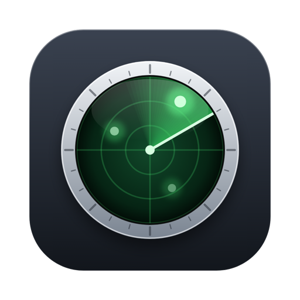
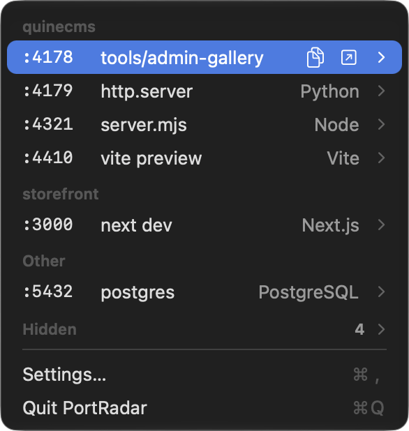

# PortRadar



**Your local dev servers, in the menu bar.**

Native Swift and AppKit. Lists what is listening on a port and opens it with one click.



<br clear="right">

## Features

- Lists dev servers and local services by port, grouped by project or as a simple list
- Names what is running: Vite, Next.js, Python, Node, PostgreSQL and more
- Click a row to open `http://localhost:PORT`; the copy icon copies the address
- Each row's submenu reveals the project folder in Finder or stops the process
- Keeps macOS daemons, apps and coding-agent CLIs under a collapsed **Hidden** header
- The menu bar icon dims when nothing is running

## Install

Build it (below), then move **PortRadar** from `build/` into **Applications** and open it.

Requires macOS 13 or later, on Apple Silicon or Intel. The app is ad-hoc signed, not
notarized. If macOS blocks it, use **System Settings → Privacy & Security → Open Anyway**.

## Build

Requires Xcode Command Line Tools.

```sh
swift run PortRadarCoreTests   # tests
./build.sh                     # build/PortRadar.app
```

`build/PortRadar.app/Contents/MacOS/PortRadar --demo` runs with fixed sample servers and performs
no real actions. Design decisions are in [the handoff note](docs/wiki/handoff.md).
